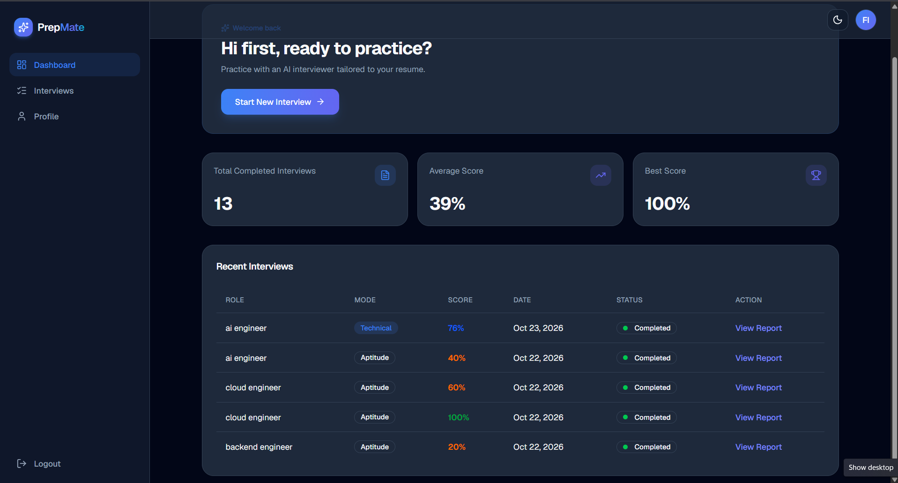
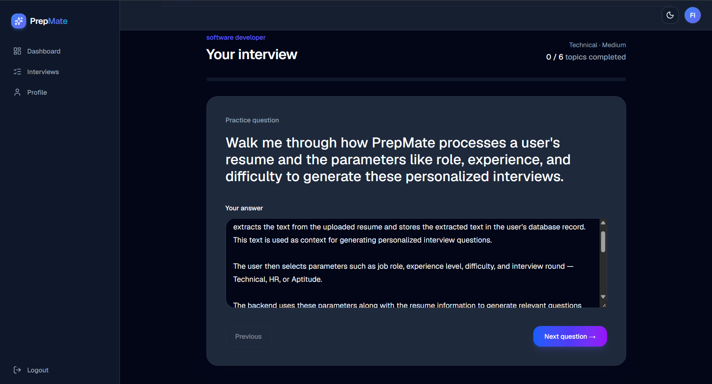
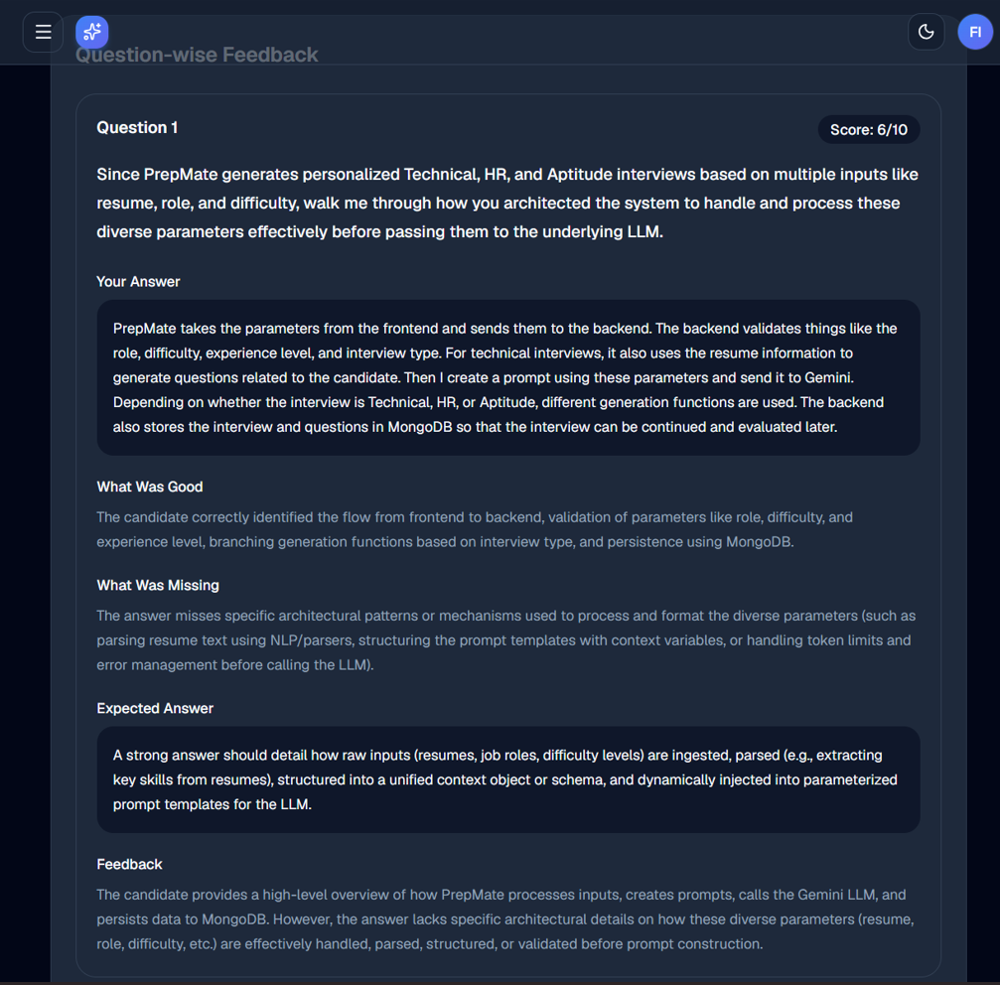
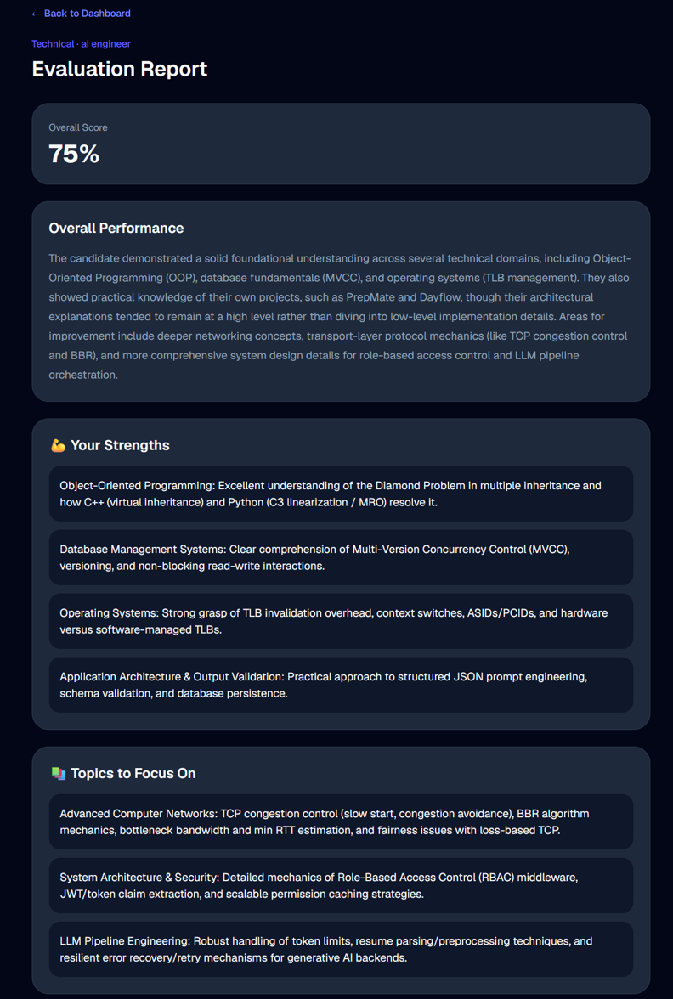
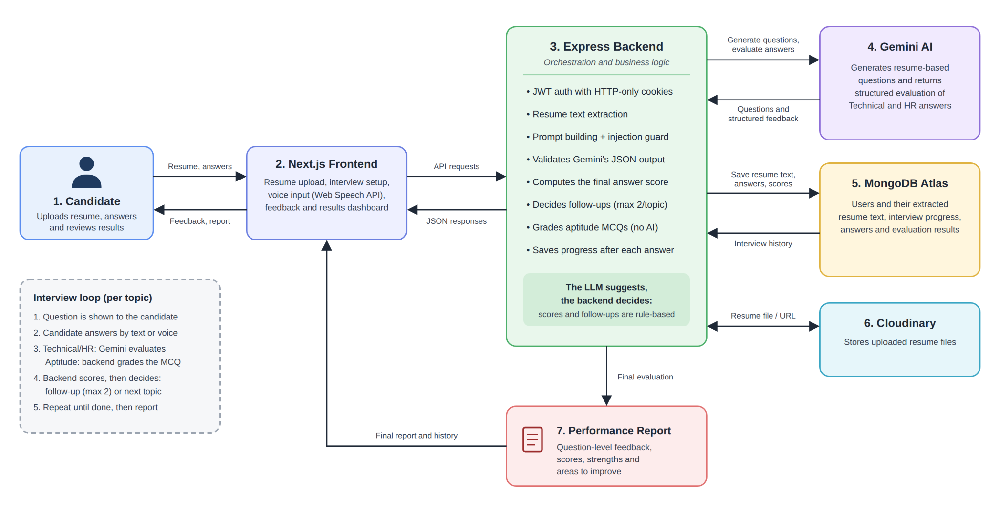

# PrepMate — AI-Powered Interview Preparation Platform

PrepMate is an AI-powered mock interview platform that helps candidates prepare for **Technical, HR, and Aptitude interviews** through personalized questions, AI-driven answer evaluation, and detailed performance reports.

The platform generates interview questions grounded in an uploaded resume, evaluates answers across multiple dimensions, asks relevant follow-up questions, and helps candidates identify areas for improvement.

**Live Demo:** [PrepMate](https://prep-mate-psi.vercel.app)

**Repository:** [github.com/hy-shivani/PrepMate](https://github.com/hy-shivani/PrepMate)

---

## Table of Contents

- [Overview](#overview)
- [Features](#features)
- [Screenshots](#screenshots)
- [How It Works](#how-it-works)
- [Tech Stack](#tech-stack)
- [System Architecture](#system-architecture)
- [Component Overview](#component-overview)
- [AI Evaluation and Benchmarking](#ai-evaluation-and-benchmarking)
- [Project Structure](#project-structure)
- [Getting Started](#getting-started)
- [Environment Variables](#environment-variables)
- [Running the Application](#running-the-application)
- [Running the Evaluation Benchmark](#running-the-evaluation-benchmark)
- [Engineering Decisions](#engineering-decisions)
- [Security Considerations](#security-considerations)
- [Future Improvements](#future-improvements)
- [Author](#author)

---

## Overview

Interview preparation often requires candidates to switch between different resources for technical questions, aptitude practice, communication improvement, and feedback. PrepMate brings these activities together in one platform.

Users can upload their resumes, configure mock interviews, answer AI-generated questions, receive question-level feedback, and review their performance through a final evaluation report.

The project also explores **LLM evaluation and reliability**, including structured-output validation, follow-up decision accuracy, score agreement, prompt-injection testing, and response latency.

## Features

### Personalized Interview Preparation

- Upload a resume to generate relevant interview questions.
- Configure the job role, experience level, difficulty, and interview mode.
- Practice Technical, HR, and Aptitude rounds.
- Generate questions grounded in the available resume information.

### AI-Powered Answer Evaluation

Answers are evaluated across five dimensions:

- **Correctness:** Accuracy of the answer.
- **Relevance:** How well the answer addresses the question.
- **Clarity:** How clearly the candidate communicates the answer.
- **Understanding:** Evidence of conceptual understanding.
- **Completeness:** Coverage of important points.

The platform provides a score, feedback, strengths, missing concepts, and an expected answer for each evaluated question.

### Adaptive Follow-Up Questions

- Generate follow-up questions when an answer needs deeper exploration.
- Limit follow-ups to two per topic.
- Track interview progress across planned topics.
- Continue to relevant pending topics when appropriate.

### Aptitude Practice

- Practice aptitude questions as part of an interview.
- Use deterministic scoring for aptitude answers where applicable.

### Performance Reports

- Review feedback for individual questions.
- Identify strengths and topics that need improvement.
- View the final interview evaluation report.
- Access interview history and past performance through the dashboard.


## Screenshots

The following screenshots showcase the main user flows.

### 1. Dashboard



The dashboard presents interview history and performance information, including completed interviews, average and best scores, and recent interview activity.

### 2. Interview Session



Candidates answer questions in an interview interface that displays the current round, difficulty, and interview progress.

### 3. Question-Level Feedback



After answering a question, candidates can review their score, strengths, missing concepts, expected answer, and detailed feedback.

### 4. Final Evaluation Report



The final report summarizes interview performance, highlights strengths, and identifies topics to focus on in future practice.

---

## How It Works

1. **Upload a resume:** The candidate uploads a resume, which is processed to extract relevant text.
2. **Configure an interview:** The candidate selects the job role, experience level, difficulty, and interview mode.
3. **Generate questions:** The backend uses Gemini to generate questions based on the interview configuration and available resume information.
4. **Answer questions:** The candidate submits written answers through the interview interface.
5. **Evaluate responses:** The AI evaluates the answer and returns structured feedback.
6. **Ask follow-ups:** The interview flow can generate relevant follow-up questions, with a maximum of two follow-ups per topic.
7. **Save progress:** Interview progress and evaluation data are stored in MongoDB.
8. **Review results:** The candidate reviews question-level feedback and the final evaluation report.

## System Architecture

The following diagram illustrates PrepMate's architecture, including the frontend, backend, AI evaluation, database, resume storage, and interview workflow.



---

## Tech Stack

| Layer | Technologies |
|---|---|
| Frontend | Next.js 16, React 19, TypeScript |
| Styling | Tailwind CSS 4, shadcn/ui |
| Backend | Node.js, Express 5 |
| Database | MongoDB, Mongoose |
| AI Integration | Google Gemini, `@google/genai` |
| Authentication | JWT, HTTP-only cookies |
| Resume Storage | Cloudinary |
| Frontend Deployment | Vercel |
| Backend Deployment | Render |

---

## Component Overview

PrepMate follows a frontend-backend architecture with a separate AI service layer.

### Frontend

The Next.js frontend handles:

- User interaction and interview configuration.
- Resume upload and interview setup.
- Question presentation and answer submission.
- Progress tracking and evaluation display.
- Dashboard, interview history, and reports.

### Backend

The Express backend handles:

- Authentication and session-related operations.
- Interview creation and retrieval.
- Resume upload and processing.
- Interview progress and answer persistence.
- Communication with the AI service.
- Evaluation results and report data.

### AI Service

The AI service is maintained in `backend/service/ai.js`. It handles AI-related operations such as question generation and answer evaluation.

Structured prompts are used to obtain consistent evaluation fields, while benchmark tests help measure the behavior of the evaluator.

### Database

MongoDB stores application data, including users, interview configurations, questions, submitted answers, evaluation results, and progress information.

### External Services

- **Gemini:** Question generation and answer evaluation.
- **Cloudinary:** Resume file storage.
- **MongoDB Atlas:** Hosted database.
- **Vercel and Render:** Frontend and backend hosting.

---

## AI Evaluation and Benchmarking

An important part of PrepMate is evaluating the reliability of the AI evaluator rather than relying only on whether the application works.

The benchmark measures structured response quality, evaluation consistency, follow-up decisions, prompt-injection handling, and latency.

### Evaluation Metrics


| **Metric** | **Purpose** |
|---|---|
| Response-Type Accuracy | Measures how often the evaluator returns the expected response type. |
| Follow-Up Accuracy | Measures agreement between predicted and expected follow-up decisions. |
| Score MAE | Measures the average absolute difference between predicted and reference scores. Lower is better. |
| Exact Score Agreement | Percentage of cases where the predicted score exactly matches the reference score. |
| Score Agreement Within ±1 | Percentage of cases where the predicted score differs from the reference score by at most one point. |
| Dimension MAE | Measures score error across correctness, relevance, clarity, understanding, and completeness. Lower is better. |
| JSON Validity | Measures whether the evaluator's output conforms to the expected JSON structure. |
| Prompt-Injection Metrics | Measures detection performance across the tested positive and negative cases. |
| Response Latency | Measures response time using average, median (p50), and 95th-percentile (p95) latency. |


### Benchmark Results

The following results are from two evaluator versions tested on 50 cases each.

| Metric | Version 1 | Version 2 |
|---|---:|---:|
| Response-type accuracy | 94% | 94% |
| Follow-up accuracy | 82% | 94% |
| Score MAE | 0.490 | 0.606 |
| Exact score agreement | 64% (32/50) | 56% (28/50) |
| Score within ±1 | 88% | 84% |
| Correctness MAE | 0.50 | 0.56 |
| Relevance MAE | 0.40 | 0.38 |
| Clarity MAE | 0.66 | 0.56 |
| Understanding MAE | 0.52 | 0.56 |
| Completeness MAE | 0.63 | 0.92 |
| JSON validity | 100% | 100% |
| Prompt-injection precision | 100% | 100% |
| Prompt-injection recall | 100% | 100% |
| Average latency | 4,905 ms | 7,630 ms |
| Median latency (p50) | 4,623 ms | 1,909 ms |
| p95 latency | 8,134 ms | 43,441 ms |

### Interpreting the Results

The results highlight trade-offs between evaluator versions:

- **Follow-up decisions improved:** Version 2 increased follow-up accuracy from 82% to 94%.
- **Overall score agreement declined:** Version 1 had lower score MAE and higher exact agreement and within-±1 agreement.
- **Some evaluation dimensions improved:** Version 2 reduced MAE for relevance and clarity.
- **Other dimensions need further tuning:** Correctness, understanding, and completeness MAE increased in Version 2.
- **Latency requires further investigation:** Version 2 had a lower median latency but a much higher p95 latency, indicating a long-tail response-time problem.
- **Structured output was consistent:** Both versions achieved 100% JSON validity in the tested cases.

### Prompt-Injection Testing

The benchmark recorded:

- True positives: 10
- True negatives: 40
- False positives: 0
- False negatives: 0

This corresponds to 100% precision and recall on the tested dataset.

These figures describe only the tested cases; they do not establish that the system is immune to prompt injection. Broader adversarial testing and an independent holdout set are necessary for stronger conclusions.

### Benchmark Limitations

- The results cover 50 cases per version and may not represent every real-world answer.
- Benchmark accuracy depends on the quality and consistency of the reference evaluations.
- Latency can vary with model availability, network conditions, and output length.
- The results should be treated as measurements of the tested versions, not a guarantee of future model behavior.

---

## Project Structure


```text
PrepMate/
├── frontend/
│   ├── app/
│   ├── components/
│   ├── public/
│   ├── package.json
│   └── ...
├── backend/
│   ├── controllers/
│   ├── models/
│   ├── routes/
│   ├── service/
│   │   └── ai.js
│   ├── evaluation/
│   ├── index.js
│   └── package.json
├── docs/
│   ├── dashboard.png
│   ├── interview.png
│   ├── feedback.png
│   ├── architecture.png
│   └── report.png
└── README.md
```

---

## Getting Started

### Prerequisites

Make sure you have the following installed or configured:

- Node.js and npm
- MongoDB Atlas or a local MongoDB instance
- A Google Gemini API key
- A Cloudinary account for resume storage

### 1. Clone the Repository

```bash
git clone https://github.com/hy-shivani/PrepMate.git
cd PrepMate
```

### 2. Configure the Backend

Navigate to the backend directory:

```bash
cd backend
npm install
```

Create a `.env` file in the backend directory and configure the required environment variables.

### 3. Configure the Frontend

Open another terminal and navigate to the frontend directory:

```bash
cd frontend
npm install
```

Create a `.env.local` file in the frontend directory.

### 4. Start the Application

Start the backend and frontend using the commands in the sections below.

---

## Environment Variables

### Backend — `backend/.env`

Never commit `.env` or `.env.local` files, API keys, database credentials, or JWT secrets.

```env
PORT=8888
MONGODB_URI=your_mongodb_connection_string
JWT_SECRET=your_jwt_secret
GEMINI_API_KEY=your_gemini_api_key

CLOUDINARY_CLOUD_NAME=your_cloud_name
CLOUDINARY_API_KEY=your_cloudinary_api_key
CLOUDINARY_API_SECRET=your_cloudinary_api_secret

FRONTEND_URL=http://localhost:3000
```

### Frontend — `frontend/.env.local`

```env
NEXT_PUBLIC_BACKEND_URL=http://localhost:8888
```


---

## Running the Application

### Start the Backend

From the `backend/` directory:

```bash
npm start
```

The backend starts on port `8888` with the example configuration above.

### Start the Frontend

From the `frontend/` directory:

```bash
npm run dev
```

Open [http://localhost:3000](http://localhost:3000) in your browser.

### Build the Frontend

```bash
npm run build
```

To start the production frontend build:

```bash
npm start
```

---

## Running the Evaluation Benchmark

The backend contains evaluation tooling for comparing AI evaluator behavior.

From the repository root:

```bash
cd backend
node evaluation/runBenchmark.js
node evaluation/results/compareBenchmark.js
```

 A valid `GEMINI_API_KEY` must be set in `backend/.env` before running the benchmark.

Do not commit private API keys or sensitive candidate data alongside benchmark results.

---

## Engineering Decisions

### Resume-Grounded Question Generation

Questions are generated using the available resume information and interview configuration. This helps make preparation more relevant to the candidate's background.

### Structured AI Responses

The evaluator is prompted to return defined fields rather than unrestricted prose. This makes the response easier for the backend to validate, persist, and display.

### Per-Question Feedback

Feedback is saved and presented at the question level so candidates can understand what was strong, what was missing, and how an answer could improve.

### Persisting Interview Progress

Saving answers and evaluation data incrementally helps preserve progress and reduces the risk of losing an entire interview when a later AI request fails.

### Explicit Follow-Up Limits

Limiting follow-up questions to two per topic helps control interview length and keeps the interview focused.

### Evaluation Beyond a Single Score

The benchmark tracks several independent dimensions, including score agreement, follow-up accuracy, structured-output validity, prompt-injection detection, and latency. This makes trade-offs between evaluator versions easier to identify.

---

## Security Considerations

PrepMate uses several services and handles user-provided content, so security must be considered throughout the system.

- Authentication uses JWTs with HTTP-only cookies.
- API secrets should be kept in environment variables.
- Resume uploads should be validated and handled securely.
- User-provided resume text and answers should be treated as untrusted input.
- AI instructions should distinguish trusted evaluation rules from untrusted candidate content.
- AI-generated output should be validated before it is used or stored.
- Database operations should enforce appropriate user authorization.
- Prompt-injection benchmark results should not be interpreted as proof of complete protection.

Never upload real candidate resumes, personal information, API keys, or other sensitive information to a public repository.

---

## Future Improvements

Potential next steps for PrepMate include:

- Expand the evaluation dataset with more technical, HR, aptitude, and adversarial cases.
- Validate evaluator changes against a separate holdout set.
- Improve score consistency across different answer styles.
- Investigate high p95 latency and add robust retry and timeout handling.
- Add more detailed interview analytics and progress tracking.
- Add automated tests for critical frontend and backend flows.
- Improve deployment monitoring and operational error reporting.

---

## Author

**Shivani H. Y**

[GitHub Profile](https://github.com/hy-shivani)

---

## Acknowledgements

PrepMate uses Google Gemini for AI-powered question generation and answer evaluation, along with open-source tools and services that support its frontend, backend, database, and file-storage workflows.

---

*PrepMate — Practice with purpose. Learn from every answer.*
